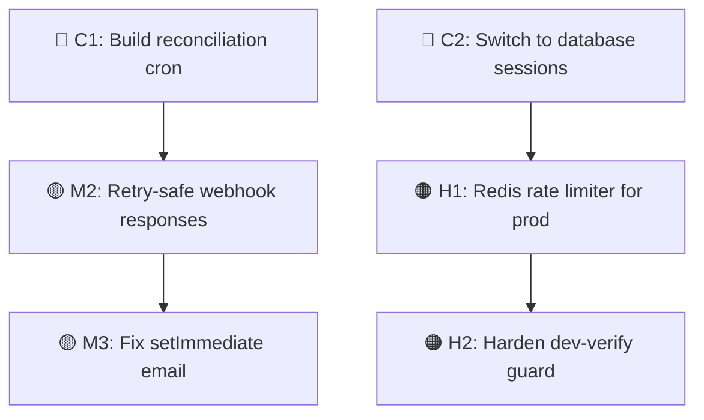

# SellSnap Payment Workflow Security Audit

**Date:** 2026-11-10  
**Scope:** End-to-end payment flow — order creation, Flutterwave integration, webhook settlement, success page, idempotency, rate limiting, auth, schema constraints, and email notifications.

---

## Overall Rating: **B+ (Strong Foundation, Notable Gaps)**

```
┌─────────────────────────────────────────────────────────┐
│  PAYMENT SECURITY SCORECARD                             │
├──────────────────────────┬──────────────────────────────┤
│  Webhook Verification    │  ██████████████████░░  9/10  │
│  Idempotency             │  ██████████████████░░  9/10  │
│  Amount/Currency Checks  │  ████████████████████  10/10 │
│  Secret Management       │  ██████████████████░░  9/10  │
│  Input Validation        │  ████████████████░░░░  8/10  │
│  Rate Limiting           │  ████████████░░░░░░░░  6/10  │
│  Auth Session Design     │  ██████████████░░░░░░  7/10  │
│  Audit Trail             │  ████████████████████  10/10 │
│  Reconciliation          │  ░░░░░░░░░░░░░░░░░░░░  0/10  │
│  Error Handling          │  ██████████████████░░  9/10  │
├──────────────────────────┼──────────────────────────────┤
│  OVERALL                 │  ████████████████░░░░  7.7   │
└──────────────────────────┴──────────────────────────────┘
```

---

## Executive Summary

The payment workflow is **well-engineered for a project at this stage**. The critical path — webhook signature verification → API verification → amount/currency matching → idempotent settlement inside a DB transaction — is correctly implemented and follows Flutterwave best practices. The codebase already handles several edge cases that many projects miss (duplicate webhook delivery, kobo/naira boundary, timing-safe hash comparison, P2002 catch).

However, there are **two critical gaps** and several medium-severity issues that should be addressed before going to production.

---

## Findings by Severity

### 🔴 CRITICAL — Must fix before production

#### C1: No Reconciliation Cron Job Exists

**Files affected:** Missing `app/api/cron/` directory entirely  
**Rule reference:** [architecture.md](file:///c:/Users/HomePC/Desktop/SellSnap/.agents/rules/architecture.md) §Background Jobs

> *"Webhook delivery is not guaranteed. The first job reconciles orders still `pending` after ~15 minutes by calling the verify endpoint by `transactionReference`."*

**Current state:** The `app/api/cron/` directory does not exist. There is zero reconciliation infrastructure. If Flutterwave fails to deliver a webhook (network issue, temporary outage, their retry budget exhausted), the order stays `pending` **forever**. The buyer is charged but the seller is never notified.

**Impact:** **Money loss.** A buyer pays, Flutterwave captures the funds, but SellSnap never settles the order. The seller never sees the payment in their dashboard. The buyer sees "Confirming Payment" indefinitely.

**Recommendation:**
1. Create `app/api/cron/reconcile/route.ts` — a secret-protected GET handler that:
   - Queries all orders where `status = 'pending'` and `createdAt < NOW() - 15 minutes`
   - For each, calls `verifyTransactionByRef(order.transactionReference)`
   - Feeds verified results into `settleVerifiedTransaction()`
   - Logs each reconciliation attempt to `PaymentLog`
2. Configure a cron trigger (Vercel Cron, external scheduler) to hit it every 5 minutes.
3. Protect with a `CRON_SECRET` header check using timing-safe comparison.

---

#### C2: Auth Uses JWT Strategy, Not Database Sessions

**File:** [`lib/auth.ts`](file:///c:/Users/HomePC/Desktop/SellSnap/lib/auth.ts#L19-L20)

```typescript
session: {
  strategy: 'jwt',  // ← Line 20
```

**Rule reference:** [architecture.md](file:///c:/Users/HomePC/Desktop/SellSnap/.agents/rules/architecture.md) §Authentication; [security.md](file:///c:/Users/HomePC/Desktop/SellSnap/.agents/rules/security.md) §Authentication

> *"Sessions are NextAuth with a **database session strategy**."*  
> *"Logout invalidates the session on the server side by **deleting the session record**, not just the cookie."*

**Current state:** The code uses `strategy: 'jwt'`. JWT sessions are stateless — there is no session record in the database to delete. The code does have a clever `passwordChangedAt` check that invalidates JWTs after password changes, but this doesn't satisfy the architectural requirement.

**Impact:**
- **Session revocation on logout is impossible.** Deleting a cookie on the client side does not invalidate the JWT. A stolen JWT remains valid until it expires (30 days).
- **Forced logout across devices** after a password change works (via the `passwordChangedAt` check), but explicit logout does not.
- The Prisma schema already has `Session` and `Account` models for database sessions, but they're unused by the JWT strategy.

**Recommendation:** Switch to `strategy: 'database'` using the PrismaAdapter. The schema already has the required models. This enables server-side logout by deleting the session row. The `passwordChangedAt` invalidation logic can be preserved as a defense-in-depth layer.

> [!IMPORTANT]
> This is rated Critical because of the 30-day window where a stolen cookie/JWT works even after the user logs out. For a payments app, session revocation is a hard requirement.

---

### 🟠 HIGH — Should fix before production

#### H1: Rate Limiter Is In-Memory Only, No Redis

**File:** [`lib/rate-limit.ts`](file:///c:/Users/HomePC/Desktop/SellSnap/lib/rate-limit.ts#L11)

```typescript
const store = new Map<string, RateLimitRecord>();
```

**Rule reference:** [security.md](file:///c:/Users/HomePC/Desktop/SellSnap/.agents/rules/security.md) §Rate Limiting

> *"Use an in-memory limiter for development and a **Redis-backed one for production**."*

**Current state:** The rate limiter uses an in-memory `Map`. On Vercel (serverless), each function invocation may run in a fresh instance. The Map is per-instance and per-invocation, meaning the rate limit is effectively **never enforced in production** — each cold start gets a fresh Map.

**Impact:** Card testing attacks on `/api/orders` and credential stuffing on `/api/auth/signup` are unchecked in production.

**Recommendation:** Add a Redis-backed rate limiter for production (e.g., Upstash Redis, which has a free tier and a Vercel integration). Keep the in-memory fallback for development.

---

#### H2: `verifyOrderOnBuyerReturn` Creates a Non-Webhook Settlement Path

**File:** [`lib/payments.ts`](file:///c:/Users/HomePC/Desktop/SellSnap/lib/payments.ts#L303-L312)

```typescript
export async function verifyOrderOnBuyerReturn(
  transactionReference?: string,
  transactionId?: number
): Promise<SettlementResult | null> {
  if (process.env.NODE_ENV === 'production') {
    return null;  // ← Guard
  }
  return verifyAndSettleOrder({ transactionReference, transactionId });
}
```

**Called from:** [`app/p/[slug]/success/page.tsx`](file:///c:/Users/HomePC/Desktop/SellSnap/app/p/%5Bslug%5D/success/page.tsx#L74) (line 74)

**Current state:** This function settles payments from the browser redirect, guarded only by `process.env.NODE_ENV === 'production'`. The guard is sound, and the function is clearly documented as dev-only. However:

1. **`NODE_ENV` is not `FLW_SECRET_HASH`-level security.** If someone deploys with `NODE_ENV` unset or set to `development` by mistake, the buyer redirect becomes a settlement path — any user who crafts a `transaction_id` query param can trigger settlement without a webhook.
2. **The `verifyAndSettleOrder` function calls `verifyTransactionByRef`**, which hits Flutterwave's API. This is correct verification, but it bypasses the webhook signature check entirely, which is the primary trust boundary.

**Impact:** Low probability (requires misconfigured deployment), but high impact (bypasses webhook-only settlement rule).

**Recommendation:**
- Add a second guard: check an explicit `ENABLE_DEV_VERIFY=true` env var, not just `NODE_ENV`.
- Or: compile it out entirely using `process.env.NODE_ENV !== 'production'` with dead-code elimination (Next.js does this for `process.env.NODE_ENV` comparisons in server code, but only at build time, and only if the check is a direct `===` comparison — which it is here, so this may already work).

---

#### H3: `env.ts` Silently Passes Invalid Config in Development

**File:** [`lib/env.ts`](file:///c:/Users/HomePC/Desktop/SellSnap/lib/env.ts#L19-L23)

```typescript
if (process.env.NODE_ENV === 'production') {
  throw new Error(`Missing required environment variables: ${missing.join(', ')}`);
}
// In dev, falls through to raw process.env cast
return result.success ? result.data : (process.env as unknown as z.infer<typeof envSchema>);
```

**Rule reference:** [architecture.md](file:///c:/Users/HomePC/Desktop/SellSnap/.agents/rules/architecture.md) §Environments and Configuration

> *"Validated at boot by zod in `lib/env.ts`, and the app refuses to start if a required one is missing."*

**Current state:** In development, if `FLW_SECRET_HASH` is missing, the app starts anyway and casts `process.env` to the expected type. This means `process.env.FLW_SECRET_HASH` will be `undefined`, and the `isValidSecretHash` function will correctly reject webhooks (it checks `!secret`), but:

- The developer gets no startup warning that webhook verification is broken.
- `FLW_SECRET_KEY` being absent would cause `authHeaders()` to throw at runtime, but only when a payment link is created — not at boot.

**Impact:** Developer confusion in local testing; no production impact since production throws on missing vars.

**Recommendation:** At minimum, log a warning listing missing variables in development mode. The current silent passthrough violates the "refuses to start" rule.

---

#### H4: `FLW_PUBLIC_KEY` Not in `env.ts` Validation

**File:** [`lib/env.ts`](file:///c:/Users/HomePC/Desktop/SellSnap/lib/env.ts)

**Rule reference:** [architecture.md](file:///c:/Users/HomePC/Desktop/SellSnap/.agents/rules/architecture.md) §Environments and Configuration — `FLW_PUBLIC_KEY` is listed as a required canonical variable.

**Current state:** `FLW_PUBLIC_KEY` is not in the zod schema. It's also not referenced anywhere in the codebase (Flutterwave's hosted checkout doesn't need it client-side since the server generates the payment link). However, if the public key is ever needed (e.g., for Flutterwave Inline JS), its absence won't be caught at boot.

**Impact:** Low — currently unused, but the validation schema is incomplete vs. the canonical list.

---

### 🟡 MEDIUM — Should address in the near term

#### M1: `Payment.gatewayReference` Lacks a Unique Constraint

**File:** [`prisma/schema.prisma`](file:///c:/Users/HomePC/Desktop/SellSnap/prisma/schema.prisma#L65)

```prisma
gatewayReference String  // ← No @unique
```

**Rule reference:** [security.md](file:///c:/Users/HomePC/Desktop/SellSnap/.agents/rules/security.md) §Payments

> *"`Payment.gatewayReference` is **not** unique — that constraint is planned hardening and does not exist yet"*

**Current state:** The rules explicitly document this as a known gap. The current idempotency relies on `Payment.orderId @unique`, which is correct and sufficient. However, without `@unique` on `gatewayReference`, if Flutterwave somehow reuses a transaction ID across different orders (extremely unlikely but theoretically possible), two Payment rows could reference the same gateway transaction.

**Impact:** Low probability; the existing `orderId` uniqueness is the primary guard. This is hardening, not a vulnerability.

**Recommendation:** Add `@unique` to `gatewayReference` when convenient. This is already documented as planned.

---

#### M2: Webhook Returns 200 on Verification Failure

**File:** [`app/api/webhooks/flutterwave/route.ts`](file:///c:/Users/HomePC/Desktop/SellSnap/app/api/webhooks/flutterwave/route.ts#L94)

```typescript
return NextResponse.json({ ok: true, data: { status: 'unverified' } }, { status: 200 });
```

**Current state:** When `verifyTransaction()` returns null (Flutterwave API unreachable, network timeout, etc.), the webhook responds with `200`. This tells Flutterwave "I processed this successfully, don't retry."

**Impact:** If the verification fails due to a transient error (network blip, Flutterwave API momentary downtime), the webhook won't be retried. The order stays pending. Without a reconciliation cron (see C1), this is a silent payment loss.

**Recommendation:** Return `500` or `503` when verification fails due to a transient error, so Flutterwave retries. Only return `200` for permanent failures (invalid transaction ID, etc.). This requires distinguishing transient from permanent failures in `verifyTransaction()`.

> [!NOTE]
> This finding's severity drops from High to Medium if the reconciliation cron (C1) is implemented, since the cron would catch these cases.

---

#### M3: Email Notification Uses `setImmediate` — Not Reliable on Serverless

**File:** [`lib/jobs.ts`](file:///c:/Users/HomePC/Desktop/SellSnap/lib/jobs.ts#L16)

```typescript
setImmediate(async () => {
  // ... send email ...
});
```

**Rule reference:** [architecture.md](file:///c:/Users/HomePC/Desktop/SellSnap/.agents/rules/architecture.md) §Background Jobs

> *"Emails and seller notifications are queued after the database transaction commits — never awaited inside a webhook or cron response."*

**Current state:** `setImmediate` defers execution to the next event loop tick. On Vercel serverless, the function may be frozen or terminated after the response is sent. The `setImmediate` callback is **not guaranteed to execute**.

**Impact:** Seller email notifications may silently fail. The payment is settled correctly (the database is updated), but the seller isn't notified via email.

**Recommendation:**
- Short term: `await` the email send (it's fast) — the webhook is already returning before this point in the call stack, and the cost is a few hundred milliseconds.
- Long term: Use a proper job queue (Vercel Cron + a `pendingNotifications` table, or an external queue like QStash).

---

#### M4: Webhook Schema Marks `tx_ref` and `status` as Optional

**File:** [`app/api/webhooks/flutterwave/route.ts`](file:///c:/Users/HomePC/Desktop/SellSnap/app/api/webhooks/flutterwave/route.ts#L16-L18)

```typescript
data: z.object({
  id: z.coerce.number().int(),
  tx_ref: z.string().optional(),   // ← Optional
  status: z.string().optional(),   // ← Optional
}),
```

**Current state:** These fields are always present in Flutterwave's `charge.completed` payloads. Making them optional means a payload with `{ data: { id: 123 } }` passes validation, and the downstream code in `settleVerifiedTransaction` relies on the **verify API response** for `tx_ref` and `status`, not the webhook body. So this is safe in practice — the webhook body values are unused.

**Impact:** No direct vulnerability. The leniency means the schema accepts payloads that would never come from Flutterwave, but since the verify API is the source of truth, this is a code-quality issue, not a security issue.

---

#### M5: No `Content-Type` Validation on Webhook

**File:** [`app/api/webhooks/flutterwave/route.ts`](file:///c:/Users/HomePC/Desktop/SellSnap/app/api/webhooks/flutterwave/route.ts#L36)

**Current state:** The webhook handler calls `req.json()` without checking that the `Content-Type` is `application/json`. Next.js will attempt JSON parsing regardless, but explicitly checking prevents confusion from form-encoded or XML payloads that somehow pass through.

**Impact:** Very low — `req.json()` will throw on non-JSON bodies, which is caught by `.catch(() => null)` and results in a `400` response. This is defense-in-depth only.

---

### 🟢 LOW — Informational / Nice-to-have

#### L1: Double DB Query on Product Page

**File:** [`app/p/[slug]/page.tsx`](file:///c:/Users/HomePC/Desktop/SellSnap/app/p/%5Bslug%5D/page.tsx)

`generateMetadata` and the page component both call `db.product.findUnique` with the same slug. This doubles the database load on every product page view.

**Recommendation:** Use React's `cache()` to deduplicate the query.

---

#### L2: Order Creation Doesn't Check for Duplicate Pending Orders

**File:** [`app/api/orders/route.ts`](file:///c:/Users/HomePC/Desktop/SellSnap/app/api/orders/route.ts#L56)

A buyer can spam "Pay Now" and create multiple pending orders for the same product. Each gets a unique `transactionReference`, so idempotency is preserved (only one can be paid), but this creates database noise.

**Impact:** No money risk — only the one with a matching Flutterwave transaction settles. But it does create orphaned pending orders.

**Recommendation:** Consider a cooldown check (same `buyerEmail` + `productId` within 60 seconds → reject).

---

#### L3: `buyerEmail` Logged in Email Notification

**File:** [`lib/jobs.ts`](file:///c:/Users/HomePC/Desktop/SellSnap/lib/jobs.ts#L42)

```typescript
logger.info('notification.order_paid.dispatched', {
  orderId,
  sellerEmail,
  amountFormatted,
  buyerEmail,  // ← PII in logs
});
```

**Rule reference:** [security.md](file:///c:/Users/HomePC/Desktop/SellSnap/.agents/rules/security.md) §Logging

> *"Never log: ... buyer email unless required for incident response"*

**Impact:** Buyer email addresses are being written to logs. This is PII leakage in the structured logs.

**Recommendation:** Remove `buyerEmail` and `sellerEmail` from the log line. Log the `orderId` only — that's enough for tracing.

---

## What's Done Right ✅

These are the things the codebase handles well — important to acknowledge because they represent deliberate, correct engineering decisions:

| Area | Implementation | Verdict |
|---|---|---|
| **Webhook signature** | `crypto.timingSafeEqual` with length check first | ✅ Textbook |
| **Verify API call** | Always calls Flutterwave verify after webhook receipt | ✅ Correct |
| **Amount comparison** | `koboToNaira()` conversion, underpayment check | ✅ Correct |
| **Currency check** | Verifies `currency === 'NGN'` | ✅ Correct |
| **Idempotency** | Fast-path on `order.status === 'paid'` + P2002 catch | ✅ Robust |
| **DB transaction** | Order update + Payment create wrapped in `$transaction` | ✅ Correct |
| **`tx_ref` generation** | `randomBytes(8)` at order creation, never regenerated | ✅ Correct |
| **Secret isolation** | `FLW_SECRET_KEY` only in server-side `authHeaders()` | ✅ Correct |
| **Kobo storage** | `Product.price` and `Order.amount` as `Int` in kobo | ✅ Correct |
| **Success page** | Display-only in production; never marks orders paid | ✅ Correct |
| **Audit trail** | `PaymentLog` model with append-only writes, never throws | ✅ Excellent |
| **Input validation** | Zod on order creation body | ✅ Correct |
| **Rate limiting** | Applied to order creation endpoint | ✅ Present (but see H1) |
| **Product deletion** | Returns "not available" page, not 404 | ✅ Correct |
| **Password change invalidation** | JWT `passwordChangedAt` snapshot check | ✅ Clever defense |
| **Cookie config** | `httpOnly`, `secure` in prod, `sameSite: lax` | ✅ Correct |

---

## Priority Action Plan



| Priority | Issue | Effort | Risk if Skipped |
|---|---|---|---|
| **Now** | C1 — Reconciliation cron | Medium (1-2 days) | Silent payment loss |
| **Now** | C2 — Database sessions | Medium (half day) | Stolen JWT valid for 30 days |
| **Before launch** | H1 — Redis rate limiter | Low (half day) | Card testing / credential stuffing |
| **Before launch** | H2 — Harden dev-verify | Low (1 hour) | Misconfigured deployment bypasses webhook |
| **Before launch** | M2 — Webhook retry semantics | Low (2 hours) | Transient failures not retried |
| **Before launch** | M3 — Fix email notification | Low (1 hour) | Seller not notified of payment |
| **Soon** | L3 — Remove PII from logs | Trivial | NDPR/GDPR risk |

---

## Summary Rating Breakdown

| Category | Score | Notes |
|---|---|---|
| **Core Payment Security** | **9/10** | Signature, verify, amount, currency, idempotency — all correct |
| **Infrastructure Resilience** | **4/10** | No reconciliation, in-memory rate limiter, unreliable email |
| **Session Security** | **6/10** | JWT instead of DB sessions; clever password-change guard partially compensates |
| **Code Quality** | **8/10** | Clean separation, good logging, structured errors, audit trail |
| **Compliance Readiness** | **7/10** | PII in logs needs fixing; audit trail is excellent |
| **Overall** | **7.7/10** | Strong core, needs infrastructure hardening for production |

> [!WARNING]
> **Bottom line:** The payment *logic* is sound — the money math, verification, and idempotency are correct. The gaps are in **infrastructure** (no reconciliation, ephemeral rate limiter, unreliable email delivery) and **session management** (JWT instead of database sessions). Fix C1 and C2 before accepting real money.
